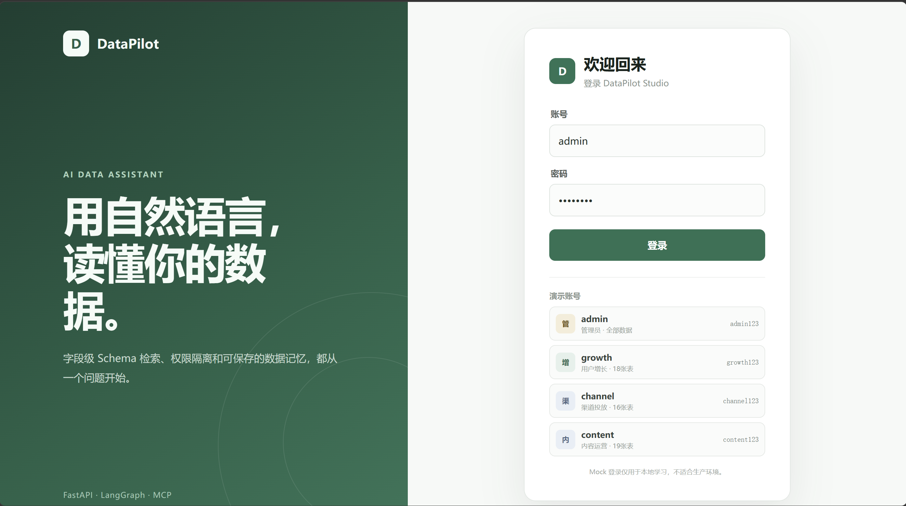
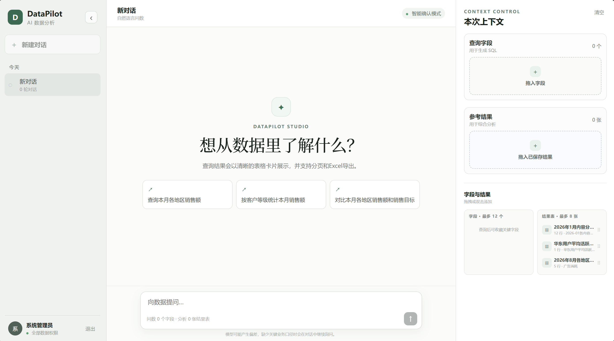
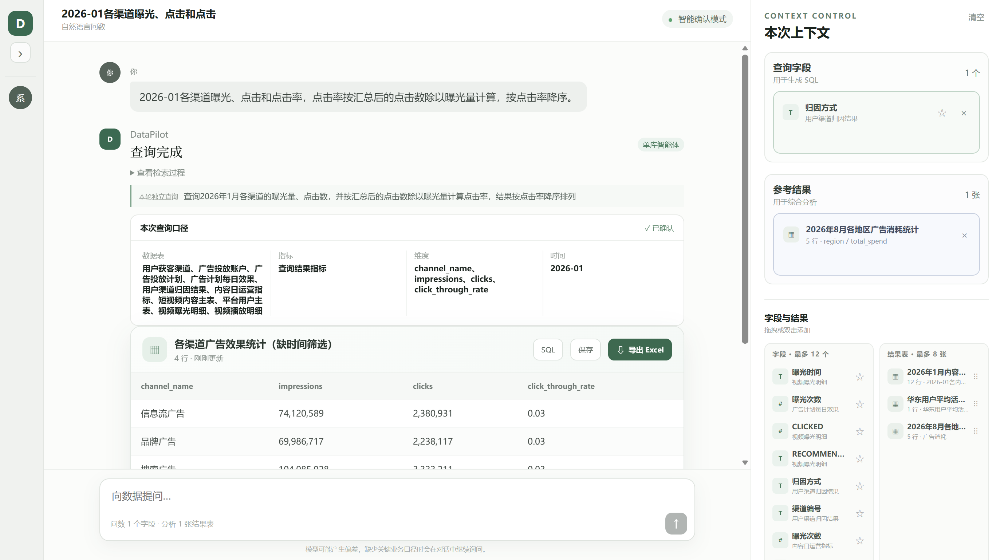
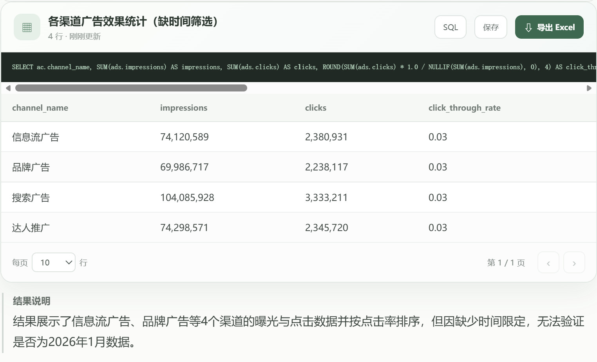
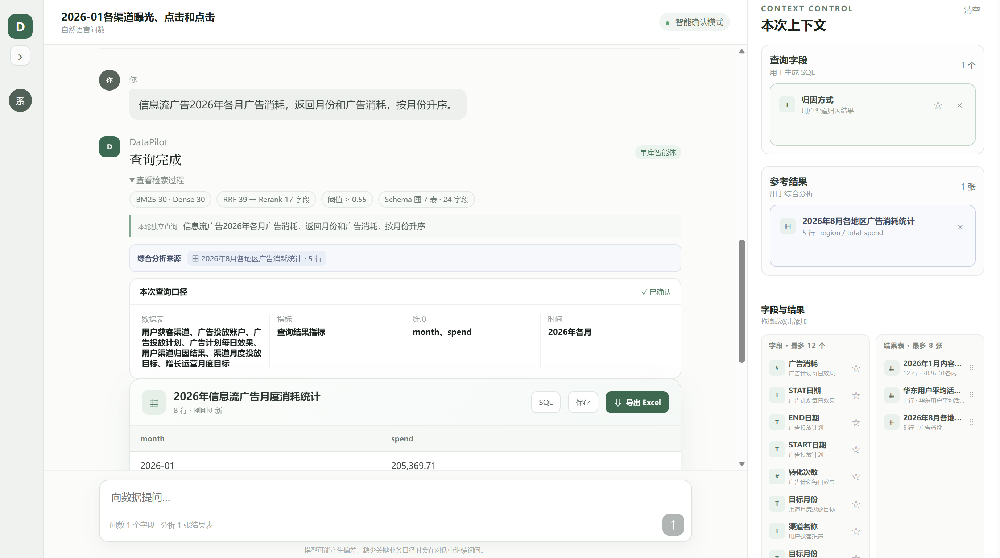
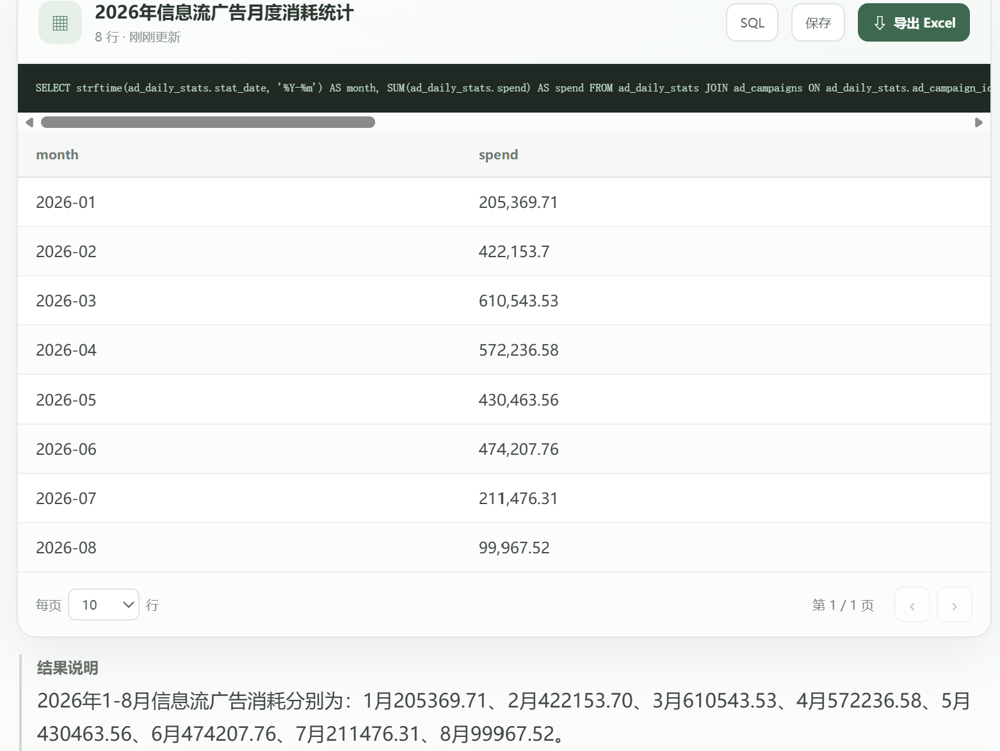

# DataPilot Studio

面向短视频平台运营场景的Text2SQL项目，包含 Vue 前端、FastAPI + LangGraph 后端、41 张 CSV 数据表、字段级 Schema 索引、测试脚本和当前评测报告。

## 界面预览

### 登录与角色权限

DataPilot 提供管理员、用户增长、渠道投放和内容运营等演示角色。不同角色对应不同的数据访问范围，便于验证字段级 Schema 检索与权限隔离能力。

<p align="center">
  
</p>

### 自然语言数据分析工作台

工作台集成对话历史、自然语言提问、查询字段、参考结果和已保存结果。用户可以直接描述分析需求，也可以将字段或历史结果加入本次上下文。

<p align="center">
  
</p>

## 运行示例

### 示例一：渠道曝光、点击与点击率分析

用户通过自然语言提出渠道效果分析需求后，系统检索相关字段、确认查询口径，生成 SQL 并以表格展示结果。

<p align="center">
  
</p>

结果卡支持查看 SQL、保存结果和导出 Excel。系统还会在结果说明中指出查询缺少月份筛选等口径风险，帮助用户判断结果是否满足原始需求。

<p align="center">
  
</p>

### 示例二：引用历史结果进行综合分析

用户可以将已保存的结果作为参考上下文，在已有分析基础上继续提问。系统会结合参考结果、检索到的 Schema 和当前问题生成新的查询。

<p align="center">
  
</p>

查询结果可展开查看生成的 SQL，并以分页表格和自然语言说明展示。下图展示了信息流广告 2026 年 1—8 月的月度消耗统计。

<p align="center">
  
</p>

## 环境要求

- Python 3.11
- Node.js 20.19 或更高版本
- 兼容 OpenAI 接口的大模型、Embedding 和 Rerank 服务

## 安装

以下命令均从解压后的项目根目录执行。

后端（Windows PowerShell）：

```powershell
cd backend
py -3.11 -m venv .venv
.\.venv\Scripts\python.exe -m pip install -r requirements.txt
Copy-Item .env.example .env
```

后端（macOS / Linux）：

```bash
cd backend
python3.11 -m venv .venv
./.venv/bin/python -m pip install -r requirements.txt
cp .env.example .env
```

编辑 `backend/.env`，填写 `LLM_API_KEY`。默认模型配置为 `qwen3.7-plus`、`text-embedding-v4` 和 `qwen3-rerank`。

前端：

```powershell
cd frontend
npm install
```

## 启动

分别打开两个终端。

后端（Windows）：

```powershell
cd backend
.\.venv\Scripts\python.exe run.py
```

后端（macOS / Linux）：

```bash
cd backend
./.venv/bin/python run.py
```

前端：

```powershell
cd frontend
npm run dev
```

访问 `http://127.0.0.1:5173`，API 文档位于 `http://127.0.0.1:8000/docs`。

## 测试

在 `backend` 目录执行：

```powershell
.\.venv\Scripts\python.exe -m unittest discover -s tests -p "test_*.py"
.\.venv\Scripts\python.exe scripts\validate_short_video_ops.py
```

评测命令与指标说明见 `backend/evaluation/README.md`。现有评测结果位于 `backend/evaluation/results`。

## 测试账号

- 管理员：`admin` / `admin123`
- 用户增长运营：`growth` / `growth123`
- 渠道投放运营：`channel` / `channel123`
- 内容运营：`content` / `content123`
